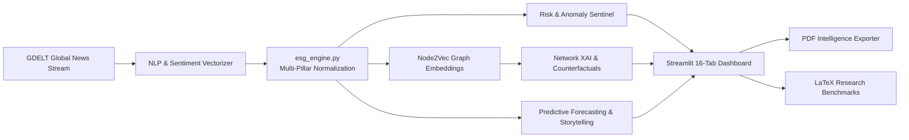

# SustainScore AI: ESG Score Estimator Using GDELT Dataset
[](https://www.python.org/downloads/)
[](https://streamlit.io/)
[](https://opensource.org/licenses/MIT)
[](https://www.gdeltproject.org/)
[]()

> **An enterprise-grade AI framework for dynamic, news-driven ESG scoring, Explainable Graph Neural Network (Node2Vec) competitor discovery, proactive risk anomaly detection, and automated research benchmarking.**

---

## 📌 Executive Summary

Traditional corporate ESG ratings rely heavily on self-disclosed annual corporate social responsibility (CSR) filings that suffer from self-reporting bias, greenwashing, and lag behind real-world controversies by up to 12 months.

**SustainScore AI** bridges this gap by continuously monitoring unstructured global news events via the **GDELT (Global Database of Events, Language, and Tone)** project. By fusing continuous sentiment analysis, statistical outlier detection, deep graph representation learning (**Node2Vec**), and Explainable AI (**XAI**), the platform delivers daily-updated, multi-pillar ESG intelligence, peer risk contagion alerts, and publication-ready empirical benchmarks.

---

## 🚀 Key Features

### 1. Dynamic Multi-Pillar Scoring (`esg_engine.py`)
- Normalization and decomposition of unstructured media sentiment into **Environmental (E)**, **Social (S)**, and **Governance (G)** pillars.
- Statistical momentum calculation (first-order derivative of rolling ESG trajectory) and sector gap benchmarking.

### 2. Explainable Graph Neural Embeddings & Network XAI (`modules/graph_explainability.py`)
- **Node2Vec Embeddings**: Learns low-dimensional latent graph embeddings from entity co-occurrence networks in international news.
- **Interactive Pyvis Ego-Networks**: Physics-simulated visual inspection of competitor and supplier ecosystem links.
- **Interactive "What-If" (Counterfactual) Analysis**: Simulates the effect of removing specific sentiment shocks or ESG pillars on network link confidence.

### 3. ESG Risk Sentinel & Anomaly Engine (`modules/risk_engine.py`)
- Dynamic Z-score statistical thresholding and rolling volatility metrics to detect acute corporate controversies, media sentiment shocks, and reputational risk spikes.

### 4. Empirical Evaluation & Academic Benchmarking (`modules/evaluation_engine.py`)
- Built specifically for peer-reviewed conference publications (**IEEE / ACM / AAAI / ACL**).
- **Task 1: ESG Score Alignment** (Pearson $r$, Spearman $\rho$, MAE, RMSE, Top-5 NDCG Ranking).
- **Task 2: Competitor Link Prediction** (ROC-AUC, Hit Rate @ 5, Mean Reciprocal Rank).
- **Task 3: Risk Sentinel Anomaly Detection** (Precision, Recall, F1-Score, ROC-AUC).
- **Task 4: XAI Faithfulness & Counterfactual Fidelity**.
- **Automated LaTeX Table Exporter**: One-click download of formatted LaTeX `.tex` tables for direct Overleaf import.

### 5. Automated Intelligence Reporting (`modules/report_generator.py`)
- Generates exhaustive multi-page PDF intelligence briefings synthesizing executive KPIs, momentum charts, peer matrices, article links, and risk summaries using ReportLab.

---

## 🏗️ System Architecture



---

## 📊 Dashboard Modules (16 Analytical Tabs)

| Tab | Module | Analytical Purpose |
|:---|:---|:---|
| **1. Overview** | Executive KPIs | Composite ESG, Sector benchmark gap, Momentum slope, Volatility. |
| **2. Individual Scores** | Micro Article Intelligence | Deep-dive into specific news items and positive/negative tone drivers. |
| **3. Trends & Momentum** | Trajectory Velocity | Rolling derivatives tracking whether ESG performance is accelerating or decaying. |
| **4. Monthly Analysis** | Macro Trends | Aggregated monthly performance breakdown across E, S, and G. |
| **5. Weekly Analysis** | Operational Momentum | Short-term sentiment shifts and operational controversy tracking. |
| **6. AI Prediction** | Trajectory Forecasting | Statistical forecasting of short-term future score behavior. |
| **7. Risk Intelligence** | Anomaly Alerts | Severity-flagged alerts for acute tone drops and volatility spikes. |
| **8. Score Breakdown** | Pillar Factor XAI | Relative weighting breakdown explaining how composite scores are formed. |
| **9. Performance Story** | Narrative Generation | Automated plain-English chronology of significant corporate events. |
| **10. Rankings & Comparison**| Peer Matrix | Cross-industry league tables and relative percentile standings. |
| **11. Distributions** | Statistical Outliers | Boxplots, standard deviation, and quartile distribution across metrics. |
| **12. Correlations & Radar** | Cross-Pillar Radar | Pearson correlation heatmap and multi-dimensional radar comparison. |
| **13. Recommendations** | Action Engine | Prescriptive operational suggestions to address identified pillar weaknesses. |
| **14. Advanced GDELT** | Entity Intelligence | Frequency breakdown of mentioned persons, locations, and media publishers. |
| **15. Network XAI** | Graph Explainability | Interactive Pyvis ego-network + What-If Counterfactual simulation. |
| **16. Academic Benchmarks**| Research Evaluation | Quantitative metrics (Pearson, Spearman, AUC, MRR) + LaTeX table export. |
| **17. Download Report** | Executive PDF Export | Full 1:1 multi-page PDF intelligence dossier. |

---

## 📂 Repository Structure

```text
├── app.py                      # Core Streamlit dashboard (16 tabs orchestration)
├── esg_engine.py               # Pure-Pandas vector scoring & benchmark computation
├── recommendation_engine.py    # Prescriptive corporate action generator
├── download_data.py            # Dataset loader and path resolver
├── gdelt_fetcher.py            # GDELT 2.0 API ingestion pipeline
├── reprocess_gdelt.py          # Data cleaning and aggregation pipeline
├── plots.py                    # Pyvis ego-network & interactive chart rendering
├── plot_setup.py               # Theme palettes and formatting definitions
├── company_profiles.json       # Corporate entity background metadata
├── requirements.txt            # Project dependencies
├── .gitignore                  # GitHub ignore rules (protects large files)
├── modules/
│   ├── evaluation_engine.py    # Empirical evaluation suite & LaTeX table exporter
│   ├── explainability_engine.py# XAI factor attribution & pillar weighting
│   ├── graph_explainability.py # Node2Vec explanation & counterfactual simulation
│   ├── narrative_engine.py     # Automated natural language event summaries
│   ├── prediction_engine.py    # Time-series momentum forecasting
│   ├── report_generator.py     # Comprehensive ReportLab PDF generator
│   └── risk_engine.py          # Statistical volatility & anomaly detection
├── Data/                       # Historical GDELT partitions & sample datasets
└── src/                        # Data processing & graph embedding utilities
```

---

## ⚡ Installation & Quickstart

### Prerequisites
- Python `3.9` to `3.11`
- Git

### 1. Clone the Repository
```bash
git clone https://github.com/<your-username>/<your-repo-name>.git
cd <your-repo-name>
```

### 2. Set Up Virtual Environment
```bash
# Windows
python -m venv venv
.\venv\Scripts\activate

# macOS / Linux
python3 -m venv venv
source venv/bin/activate
```

### 3. Install Dependencies
```bash
pip install --upgrade pip
pip install -r requirements.txt
```

### 4. Run the Application
```bash
streamlit run app.py
```
*The web dashboard will launch automatically at `http://localhost:8501`.*

---

## 📄 License

This project is licensed under the **MIT License** — see the [LICENSE](LICENSE) file for details.